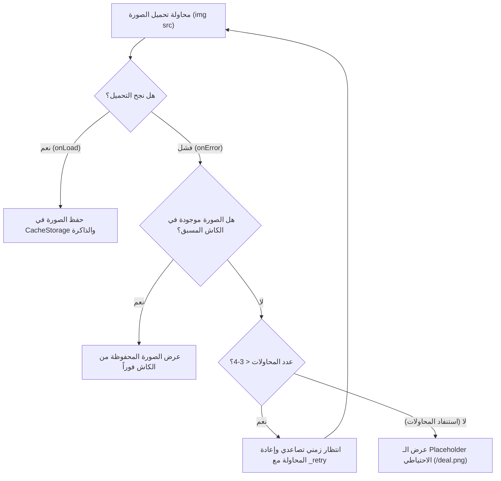

# 🥛 Alfa Milk - E-Commerce Storefront Platform
### منصة متجر ألفا ميلك للصناعات الغذائية


Welcome to the **Alfa Milk** (ألفا ميلك للصناعات الغذائية) official storefront repository. This project is an enterprise-grade, ultra-responsive, bilingual e-commerce platform engineered with **React 18**, **Vite 8**, **Redux**, and modern performance optimization techniques including **In-Memory API Caching**, **Image Retry & CacheStorage Resilience**, and **Route-Level Code Splitting**.

---

## 📑 جدول المحتويات / Table of Contents
1. [🌟 نظرة عامة على المشروع / Overview](#-نظرة-عامة-على-المشروع--overview)
2. [✨ أبرز المميزات والخصائص / Key Features](#-أبرز-المميزات-والخصائص--key-features)
3. [🛠️ البنية التقنية / Technology Stack](#️-البنية-التقنية--technology-stack)
4. [🔄 نظام استعادة وتخزين الصور / Image Resilience & Caching System](#-نظام-استعادة-وتخزين-الصور--image-resilience--caching-system)
5. [⚡ نظام كاش الـ API / API Caching & Request Deduplication](#-نظام-كاش-الـ-api--api-caching--request-deduplication)
6. [📂 هيكل المشروع ومجلداته / Project Structure](#-هيكل-المشروع-ومجلداته--project-structure)
7. [⚙️ المتغيرات البيئية / Environment Variables](#️-المتغيرات-البيئية--environment-variables)
8. [🚀 التشغيل والبناء / Installation & Development](#-التشغيل-والبناء--installation--development)
9. [🌐 روابط الـ API والـ Backend / Backend Integration](#-روابط-الـ-api-والـ-backend--backend-integration)
10. [🚢 النشر والإنتاج / Production & Deployment](#-النشر-والإنتاج--production--deployment)

---

## 🌟 نظرة عامة على المشروع / Overview

منصة **Alfa Milk** هي متجر إلكتروني متكامل لمنتجات الألبان والأغذية، يتيح للعملاء استعراض كتالوج المنتجات، اختيار الأوزان والخيارات المتعددة، الاستفادة من العروض والخصومات، قراءة مقالات المدونة، وإتمام عمليات الشراء بسلاسة عبر واجهة مستخدم فائقة السرعة وعصرية (**Neo UI System**).

The platform is designed with a mobile-first, high-performance aesthetic and integrates directly with the live Alfa Milk admin dashboard (`https://admin.alfa-milk.com/api`).

---

## ✨ أبرز المميزات والخصائص / Key Features

### 1. دعم كامل للغتين والاتجاهين (Bilingual & Full RTL/LTR)
- **العربية (افتراضي)**: دعم كامل لاتجاه اليمين لليسار (`dir="rtl"`) مع خطوط متناسقة وتخطيط مخصص.
- **الإنجليزية**: دعم التبديل السلس للإنجليزية (`dir="ltr"`) بضغطة زر وتحديث فوري لكافة النصوص والأسعار.

### 2. نظام الكاش الذكي لطلبات الـ API (In-Memory Session Caching)
- عند تحميل بيانات المنتجات أو الفئات أو الإعدادات أو المقالات، يتم تخزينها في الذاكرة طوال فترة التصفح داخل الـ SPA.
- التنقل بين الصفحات (`/`, `/shop`, `/about`, `/contact`) يتم فورياً بدون إعادة طلب البيانات من السيرفر.
- **دمج الطلبات المتزامنة (Request Deduplication)**: منع إرسال طلبات مكررة لنفس الرابط إذا كانت قيد الانتظار.
- **إعادة الجلب عند التحديث (Fresh on Refresh)**: عند قيام العميل بعمل Refresh كامل (F5)، يتم تصفير الذاكرة وجلب أحدث بيانات وتخزينها مجدداً.

### 3. نظام استعادة وتخزين الصور ضد الفشل (Image Resilience & CacheStorage)
- عند فشل تحميل أي صورة من السيرفر، يتم التحقق أولاً من وجود نسخة محفوظة مسبقاً في **CacheStorage** وعرضها فوراً.
- في حال عدم وجودها في الكاش، يعيد النظام محاولة جلب الصورة **3 إلى 4 مرات** بتأخير زمني تصاعدي (Backoff Delay) مع معلمات لتجاوز الكاش المعطوب (`_retry=1`, `_retry=2`...).
- في حال استنفاد كافة المحاولات وفشل الصورة نهائياً، يتم الانتقال تلقائياً وبأمان لعرض الـ Placeholder (`/deal.png`).
- الصور التي تنجح في التحميل يتم حفظها في الكاش تلقائياً لاستخدامها في وضع عدم الاتصال أو ضعف الشبكة.

### 4. تقسيم الكود والتحميل الكسول (Lazy Loading & Code-Splitting)
- **الموقع والمسارات**: تقسيم جميع صفحات التطبيق الـ 14 باستخدام `React.lazy()` و `<Suspense>` لتقليل حجم الحزمة الابتدائية وتحميل كل صفحة عند الحاجة فقط.
- **الصور**: إضافة `loading="lazy"` و `decoding="async"` لكافة الصور في المتجر لتقليل استهلاك موارد المتصفح وتسريع فتح الموقع.

### 5. تصحيح صفحة من نحن (About Page Polish)
- التخلص من أي نصوص ثابتة قديمة قبل وصول الـ API.
- إظهار شاشة تحميل أنيقة `<LoadingScreen />` حتى اكتمال جلب البيانات من السيرفر وعرضها بدقة.

### 6. التمرير التلقائي لأعلى الصفحة (Scroll-to-Top on Pagination)
- عند التنقل بين صفحات المنتجات في الكتالوج (`ShopPage`) أو النقر على أزرار الترقيم (`Pagination`)، ينتقل المتصفح بنعومة وسلاسة إلى أعلى الصفحة.

### 7. إدارة السلة وقائمة الرغبات (Redux Cart & Wishlist)
- مزامنة السلة وقائمة الرغبات محلياً عبر `redux-localstorage-simple` مع دعم التوكن والمزامنة مع الحساب الشخصي.
- دعم الخيارات المتعددة (الأوزان / الأحجام) لكل منتج مع حساب تلقائي لفروق الأسعار والخصومات.

---

## 🛠️ البنية التقنية / Technology Stack

| التقنية / المكتبة | الاستخدام |
| :--- | :--- |
| **React 18.3.1** | مكتبة بناء واجهة المستخدم |
| **Vite 8.1.3** | أداة البناء والتطوير فائقة السرعة |
| **Redux 4.0.4 & Redux Thunk** | إدارة الحالة العامة (State Management) |
| **React Router DOM 5.1.2** | إدارة المسارات والتنقل بين الصفحات |
| **Axios 1.7.9** | عميل استدعاء الـ APIs مع Adapter مخصص للكاش |
| **CacheStorage API** | تخزين الصور محلياً في المتصفح |
| **Sass / SCSS & Neo CSS** | تنسيق وتصميم الواجهات والأنظمة الجمالية |
| **React Toast Notifications** | إشعارات وتنبيهات المستخدم التفاعلية |
| **Vercel CLI & Configuration** | إعدادات النشر السحابي |

---

## 🔄 نظام استعادة وتخزين الصور / Image Resilience & Caching System

تم بناء وحدة مركزية في `src/helpers/imageCache.js` توفر حماية شاملة لكافة الصور في التطبيق:



- **المكون الذكي**: تم توفير مكون `<SmartImage />` في `src/neo/ui.jsx` للاستخدام المباشر.
- **الحماية العامة**: يتم تشغيل `initGlobalImageProtection()` في `src/main.jsx` لتعمل الحماية تلقائياً على مستوى الـ Window Capturing لجميع الصور.

---

## ⚡ نظام كاش الـ API / API Caching & Request Deduplication

تم تعديل `src/api/api.js` بحيث يحتوي على **Custom Axios Adapter**:
- يتم إنشاء مفتاح موحد (`CacheKey`) لكل مسار مع ترتيب معايير البحث أبجدياً.
- طلبات `GET` المخزنة تعود فوراً بدون إرسال أي طلب شبكة إضافي.
- الطلبات المتزامنة تشترك في نفس الـ Promise وتنفذ طلباً واحداً فقط.
- طلبات `POST`, `PUT`, `DELETE` لا يتم تخزينها للحفاظ على سلامة العمليات.
- دوال مساعدة مُصدّرة: `clearApiCache()` و `getCacheKey()`.

---

## 📂 هيكل المشروع ومجلداته / Project Structure

```text
Alfa-Milk-main/
├── .env                       # متغيرات البيئة ورابط الـ API
├── index.html                 # المدخل الرئيسي لـ Vite
├── vite.config.js             # إعدادات Vite ومنافذ التشغيل
├── package.json               # التبعيات والسكربتات
├── vercel.json                # قواعد إعادة التوجيه لـ Vercel
├── README.md                  # هذا الملف التوثيقي الشامل
│
├── dist/                      # حزم الإنتاج المجمعة الجاهزة للنشر
│   ├── assets/                # ملفات الـ JS والـ CSS المقسمة (Chunks)
│   └── index.html             # صفحة البداية المجهزة
│
└── src/
    ├── main.jsx               # نقطة الانطلاق وتهيئة الـ Store وحماية الصور
    ├── App.jsx                # إدارة المسارات مع React.lazy و Suspense
    │
    ├── api/
    │   └── api.js             # عميل Axios مع نظام الكاش ودمج الطلبات
    │
    ├── helpers/
    │   └── imageCache.js      # نظام كاش واستعادة الصور وإعادة المحاولات
    │
    ├── neo/                   # نظام الواجهة العصري الأساسي (Neo UI)
    │   ├── ui.jsx             # مكتبة المكونات (Navbar, Footer, Cards, SmartImage)
    │   ├── pages.jsx          # صفحات المتجر (Home, Shop, About, Blog, etc.)
    │   ├── styles.css         # التنسيقات العامة والـ CSS Variables
    │   ├── lib.js             # دوال التنسيق والعملات والأوزان
    │   └── translations.js    # قواميس الترجمة العربية والإنجليزية
    │
    ├── redux/                 # إدارة الحالة
    │   ├── actions/           # دوال الـ Cart, Wishlist, Reviews
    │   └── reducers/          # مجمعات الحالة
    │
    ├── components/            # مكونات الواجهة التكميلية
    ├── wrappers/              # الأغلفة والأقسام المنفصلة
    └── pages/                 # الصفحات الإضافية والمساعدة
```

---

## ⚙️ المتغيرات البيئية / Environment Variables

يحتوي ملف `.env` في جذر المشروع على:

```env
NODE_OPTIONS=--openssl-legacy-provider
REACT_APP_API_BASE=https://admin.alfa-milk.com/api
```

- **`REACT_APP_API_BASE`**: رابط الـ API الأساسي للإنتاج. تم توجيهه إلى `https://admin.alfa-milk.com/api`.

---

## 🚀 التشغيل والبناء / Installation & Development

### 1. تثبيت الحزم (Prerequisites)
تأكد من وجود **Node.js** (إصدار 18 أو أحدث) مثبت على جهازك، ثم نفذ:

```bash
npm install
```

### 2. تشغيل بيئة التطوير (Development Server)
لتشغيل المشروع محلياً مع التحديث المباشر السريع (Vite HMR):

```bash
npm run dev
```
سيفتح المشروع تلقائياً على الرابط: `http://localhost:3000`

### 3. بناء حزم الإنتاج (Production Build)
لبناء حزم الإنتاج المحسنة وتوليد مجلد `dist`:

```bash
npm run build
```

### 4. معاينة البناء (Preview Production Build)
لمعاينة ما تم بناؤه محلياً والتأكد من سلامة الحزم:

```bash
npm run preview
```

---

## 🌐 روابط الـ API والـ Backend / Backend Integration

يرتبط المتجر مباشرة بالسيرفر السحابي لـ Alfa Milk عبر الروابط التالية:

| الـ Endpoint | الغرض |
| :--- | :--- |
| `GET /api/settings` | إعدادات المتجر العامة، الشعار، بيانات التواصل، والتذييل |
| `GET /api/items` | كتالوج المنتجات والأوزان والأسعار والصور |
| `GET /api/cafes` | فئات وتصنيفات المنتجات (Categories) |
| `GET /api/offers` | عروض اليوم والخصومات الخاصة |
| `GET /api/blogs` | مقالات وأخبار المدونة |
| `GET /api/blog/:id` | تفاصيل المقال الكامل ومحتواه |
| `GET /api/about` | معلومات من نحن وتاريخ الشركة |
| `GET /api/sliders-web` | صور البانر والسلايدر لسطح المكتب |
| `GET /api/sliders-phone`| صور البانر والسلايدر للهواتف |
| `POST /api/review-item` | إضافة تقييم ومراجعة لمنتج |

---

## 🚢 النشر والإنتاج / Production & Deployment

المشروع مهيأ بالكامل للنشر الفوري على منصات الاستضافة السحابية:
- **Vercel**: تم تضمين `vercel.json` لمعالجة الـ SPA Routing عبر مسار الـ Rewrites إلى `/index.html`.
- **Apache Web Server**: يتضمن مجلد `dist` ملف `.htaccess` جاهز لإعادة توجيه المسارات تلقائياً.
- **Nginx**: يتم توجيه مسارات الـ SPA عبر `try_files $uri $uri/ /index.html;`.

---

### 👨‍💻 تم التطوير والتحديث بواسطة
**فريق تطوير ألفا ميلك (Farag-Sherif)**  
المستودع الرسمي على GitHub: [https://github.com/Farag-Sherif/Alfa-Milk](https://github.com/Farag-Sherif/Alfa-Milk)
